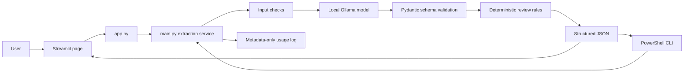

# Structured Extraction Service

> **A local-first AI app that turns one customer message into a validated, reviewable JSON record.**

**Python · Pydantic · Ollama · Qwen 3.5 4B · Streamlit · JSONL evaluation**


## Project snapshot

| | Status |
|---|---|
| Local browser app | Working with Streamlit and Ollama |
| Command-line app | Working |
| Evaluation set | 25 synthetic examples, version 0.4, included in this repository |
| Core extraction and review decisions | 23/23 exact when reason wording is ignored |
| Literal full-record match | 18/23; five review explanations use different wording |
| Public deployment | Not deployed; the model runs locally |

The evaluation is a useful learning baseline for this small synthetic set. It is not a guarantee of performance on arbitrary real-world messages.

## What it does

- Extracts a sender's name and contact, message intent, urgency, and budget signal.
- Applies deterministic Python rules to decide when a person should review an extraction.
- Rejects messages shorter than 3 characters or over the configurable limit
  (4,000 by default) before model inference.
- Shows readable result fields, review status, elapsed time, and provider-cost
  information in the local browser page, or prints JSON in PowerShell.
- Logs request metadata such as token counts and latency without logging the message or extraction output.
- Estimates remote Ollama server cost when optional input and output token rates are configured; local Ollama provider charges are $0.
- Compares model outputs with the included 25-example synthetic dataset and writes JSON, Markdown, all-example CSV, and failure-case CSV reports.

## How a message flows through the app



`app.py` is the presentation layer. `main.py` contains the shared extraction, validation, review-routing, and logging logic. `evaluate.py` runs the model against the labelled examples.

## Quick start on Windows

Open PowerShell in this folder. Keep Ollama running and check that the model is installed:

```powershell
ollama list
```

If `qwen3.5:4b` is missing, download it once:

```powershell
ollama pull qwen3.5:4b
```

Create the virtual environment only if it does not exist yet:

```powershell
python -m venv .venv
```

Activate it in this PowerShell window before running the project commands:

```powershell
.\.venv\Scripts\Activate.ps1
```

The prompt should now begin with `(.venv)`. If PowerShell blocks the activation
script, allow scripts for this window only, then activate again:

```powershell
Set-ExecutionPolicy -Scope Process -ExecutionPolicy Bypass
.\.venv\Scripts\Activate.ps1
```

Create `.env` from the example only if `.env` does not exist. Then check that it contains the local Ollama settings shown below:

```powershell
if (-not (Test-Path .env)) { Copy-Item .env.example .env }
```

```text
OLLAMA_BASE_URL=http://localhost:11434
OLLAMA_MODEL=qwen3.5:4b
MAX_MESSAGE_CHARS=4000
```

Install the project packages:

```powershell
python -m pip install -r requirements.txt
```

Start the browser app:

```powershell
python -m streamlit run app.py
```

For the command-line version, run:

```powershell
python main.py
```

## Run the evaluation

Evaluate the complete dataset:

```powershell
python evaluate.py
```

During prompt iteration, evaluate selected IDs:

```powershell
python evaluate.py --ids P02,P07,P15
```

The evaluation saves progress in `evaluation\latest_report.json`. Versioned baseline files preserve earlier runs. P22 and P24 are expected to be rejected before inference.

Each evaluation also reports precision, recall, and F1 for the classification
fields, plus contact accuracy after email/phone formatting normalization. It
updates `evaluation\latest_report.md`, `evaluation\latest_examples.csv`, and
`evaluation\latest_failures.csv`. The CSV files make per-example comparison
and error review easier in spreadsheet software.

## Cost and usage summary

The app appends metadata to `logs\usage.jsonl` without storing message text
or extracted customer fields. After running a few local requests, summarize
tokens, latency, retries, and estimated provider cost with:

```powershell
python cost_report.py
```

The summary is printed and saved to `evaluation\latest_cost_summary.json`.
It covers all events currently recorded in `logs\usage.jsonl`, including
earlier CLI, browser, and evaluation requests.
Local Ollama provider cost is always $0; electricity and hardware costs are
not measured. If using a billed remote Ollama server, set both
`MODEL_INPUT_COST_PER_1M_USD` and `MODEL_OUTPUT_COST_PER_1M_USD` in `.env` to
that server's current rates. Estimates include token usage returned for
successful or invalid model responses across retries. A timeout or transport
or server failure may not return token counts, so its remote cost can be
unknown.

## Run automated checks

Run the fast checks for input validation, schema constraints, review rules,
service behavior, and timeout retry handling:

```powershell
python -m unittest discover -s tests -v
```

The suite uses fake model responses, so it does not call Ollama. The existing
suite contains 18 checks.

### Version 0.4 evaluation

The full run processed 25 examples: 23 were eligible for inference and two were expected pre-call rejections. All 23 matched the expected extraction fields and review decisions when reason wording was ignored. Intent, urgency, budget signal, and human-review classification each had macro and micro F1 of 1.00; normalized contact matching was 23/23. Both rejections were correct, and there were no inference errors. Literal full-record exact match was 18/23 (78.3%) because the review-reason text differed from its reference wording in five cases.

## Project files

```text
structured-extraction-service/
├── app.py                  # Streamlit browser interface
├── main.py                 # Extraction service and command-line entry point
├── evaluate.py             # Dataset evaluation and metrics
├── cost_report.py          # Usage and estimated-cost summary
├── ADR-001-local-ollama.md # Record of the local-model decision
├── FAILURE_REGISTER.md     # Known failures, handling, and residual risks
├── CASE_STUDY.md           # Five-line case study from the recorded baseline
├── DEMO_SCRIPT.md          # Two-minute walkthrough outline
├── requirements.txt        # Python dependencies
├── .env.example            # Local Ollama settings template
├── .gitignore              # Excludes local secrets, notes, and generated reports
├── .streamlit/config.toml  # Streamlit color theme
├── logs/                   # Runtime metadata log (ignored by Git)
├── evaluation/             # Versioned baselines and generated reports
├── data/                   # Synthetic messages, labels, and annotation guide
│   ├── synthetic_messages.jsonl
│   ├── expected_outputs.jsonl
│   └── annotation_guide.md
└── tests/                  # Fast local unit and service-flow checks
```

## Project documentation

The [architecture decision record](ADR-001-local-ollama.md) explains why the
first version uses local Ollama. The [failure register](FAILURE_REGISTER.md)
tracks how known problems are handled and what risks remain. The
[case study](CASE_STUDY.md) and [demo script](DEMO_SCRIPT.md) summarize the
recorded baseline. Personal study guides and progress notes stay local and are
excluded from the public repository.

## Local use, privacy, and deployment

When configured with `OLLAMA_BASE_URL=http://localhost:11434` in a local `.env`, the model call stays on this computer and no hosted model API key is needed. The UI shows the provider-cost estimate and reported token count for the latest request. `logs\usage.jsonl` stores operational metadata, not message contents or extracted fields. Evaluation reports contain expected and predicted fields for the synthetic examples.

This repository has no public deployment yet. A hosted website cannot call Ollama on your personal computer through its own `localhost`; a live version needs a model endpoint reachable by the hosting service and a protected way to store its API key.

## Remaining roadmap

The local MVP and its synthetic evaluation baseline are implemented. A final
browser check and short demo recording are useful presentation polish. Personal
learning notes remain available locally and are excluded from GitHub. Public
deployment is optional and can wait until you choose a hosted inference provider.

**Current stage:** local MVP, included synthetic dataset, cost and evaluation
reports, Streamlit interface, 18 existing automated checks, and the initial
input/fallback policy complete. Run the checks and evaluation after pulling
this change; hosted deployment and live-provider checks remain deferred.
